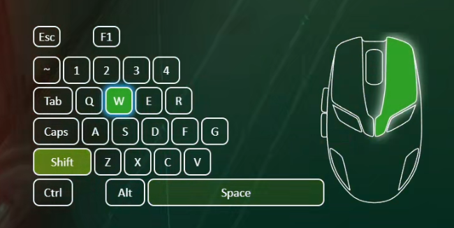
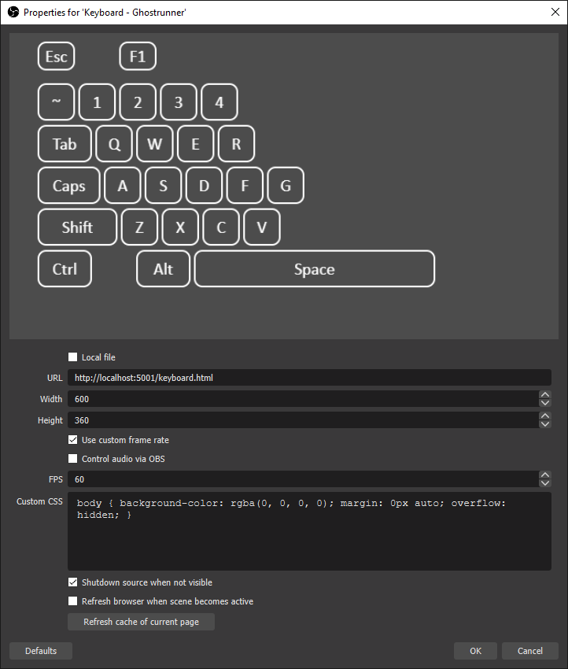

# Zergatul.Obs.InputOverlay
Input overlay plugin for OBS. Supported systems: Windows 10/11 x64



# Installation
1. Download latest release here: https://github.com/Zergatul/Zergatul.Obs.InputOverlay/releases
1. Unzip it to any location you want

# Basic usage
1. Run `Zergatul.Obs.InputOverlay.exe`, and keep it open while you want to use input overlay in OBS
1. In OBS, add Source 🡒 Browser.
    - `URL`: `http://localhost:5001/default-keyboard.html`
    - `Width`: `600`, `Height`: `360`. Use can expiriment with another values
    - Check `Use custom framerate`, and set FPS to `30`. You can set it to `60`, but please check [Performance issues](docs/PerformanceIssues.md) page first.
    - Check `Shutdown source when not visible`. This will allow you to hide/show source after you restarted the server
    - Do the same for mouse: `URL`: `http://localhost:5001/default-mouse.html`, `Width`: `250`, `Height`: `350`
    - Or gamepad: `URL`: `http://localhost:5001/XBoxSeriesX-XInput.html`, `Width`: `1000`, `Height`: `1000`. (XBoxSeriesX doesn't mean your gamepad should be this, it is should work with any XInput compatible gamepads, details in [Gamepads](docs/Modules.md#gamepads))
    - [Other modules](docs/Modules.md)



# Using OBS on another PC

For simplicity of this guide we will use 2 terms:
- Gaming PC - PC where you run a game. You want to record inputs from this PC
- OBS PC - PC where you run OBS

Remote setup does not require editing files in `wwwroot`.

First you need to find LAN IP address of gaming PC. You can run `ipconfig` from command line, find appropriate Ethernet or Wireless LAN adapter, and copy IP address. For this example we will use `192.168.1.123`

After that you need to choose a TCP port you will use for communication between Input Overlay on gaming PC and OBS on OBS PC. You have to make sure you opened this port on all firewalls that can block connections in your LAN. For this example we will use port `12345`.

Start `Zergatul.Obs.InputOverlay.exe` on gaming PC from Command Prompt or Powershell window with `listen` and `port` arguments:
```powershell
.\Zergatul.Obs.InputOverlay.exe --listen 192.168.1.123 --port 12345
```

If you get error `Specified listen ip/host is not valid`
it means IP address you specified is not valid. Check again its correctness.

If firewalls are configured properly you can try opening `http://192.168.1.123:12345/default-keyboard.html` 
in any browser on OBS PC. If it opens empty white page, everything is fine (the page is not actually white, it is fully transparent and browser renders white by default). You can try pressing WASD, Ctrl, Shift buttons and see them highlighted.

If browser can't reach this page with messages like "refused to connect", something went wrong. In this case start PowerShell from Start menu and run below command on 2 PCs with Input Overlay running:

```powershell
Test-NetConnection -ComputerName 192.168.1.123 -Port 12345
```

In the command output you should look for `TcpTestSucceeded : True`. When everything is setup correctly, you should see `True`, on both machines. If on OBS PC it is `False` but `True` on gaming PC - the problem is firewall. If it is `False` on both machines - you probably made a typo in IP address or port.

Now you can add Browser Source to your OBS. Substitute IP and port in the page URL you want to use, example: `http://192.168.1.123:12345/default-keyboard.html`

# Advanced usage
1. If you are running server application without elevated priviledges, it will not be able to detect your inputs from applications running under administrator. Example: I have game started from Steam, and command prompt, running as Administrator. Server will be able to detect inputs in game, but will show nothing when I type something in command prompt.
2. You can show more keys, change style, colors, animations if you are familiar with HTML and CSS. Check `wwwroot` folder within application folder. It contains HTML, CSS and JavaScript files. You can get all supported key names from [KeyboardButton.cs](src/Keyboard/KeyboardButton.cs) file.
3. [Customizing mouse/gamepad](docs/CustomizingMouse.md).
4. If you need to restart server application, you will need to hide sources in OBS, and show them again.
5. [Using multiple gamepads](docs/MultipleGamepads.md).
6. Run executable with `--help` to see all available options.

# Troubleshooting
If you encounter any problems with running Browser Source in OBS, you can open keyboard/mouse URL's in your browser and check for errors in developer console. In `<style>` element uncomment line: `background-color: black;`. Now open URL in your browser with Developer Tools opened (usually this is `F12` key). Don't forget to comment out this line again if you start using overlay in OBS. Sometimes browser source in OBS caches styles, you can use `Refresh cache of current page` button.

# Build application from sources
You can open solution file in Visual Studio 2022+. Program is written in C#, by using ASP.NET Core for web server. Use `Build` -> `Publish` menu option to create self-contained package.
You can also build it by using [.NET CLI](https://docs.microsoft.com/en-us/dotnet/core/tools/). Download .NET 8.0 SDK, go to `src` directory and run from command prompt: `dotnet publish -c Release -p:PublishProfile=FolderProfile`